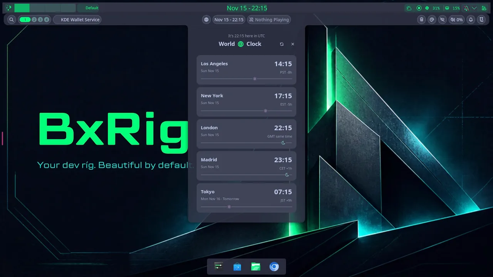
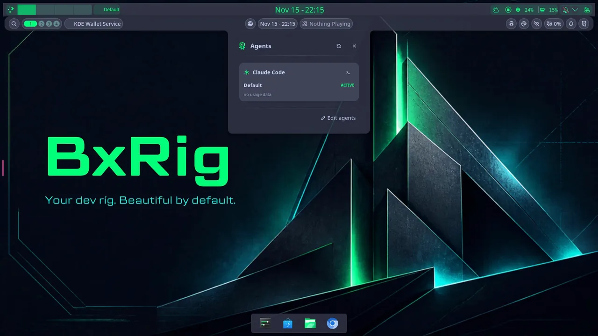
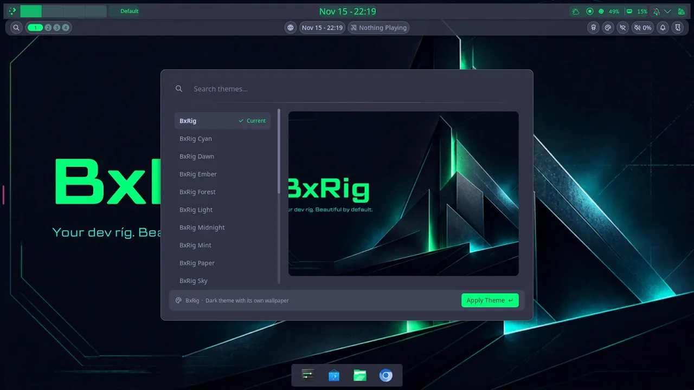
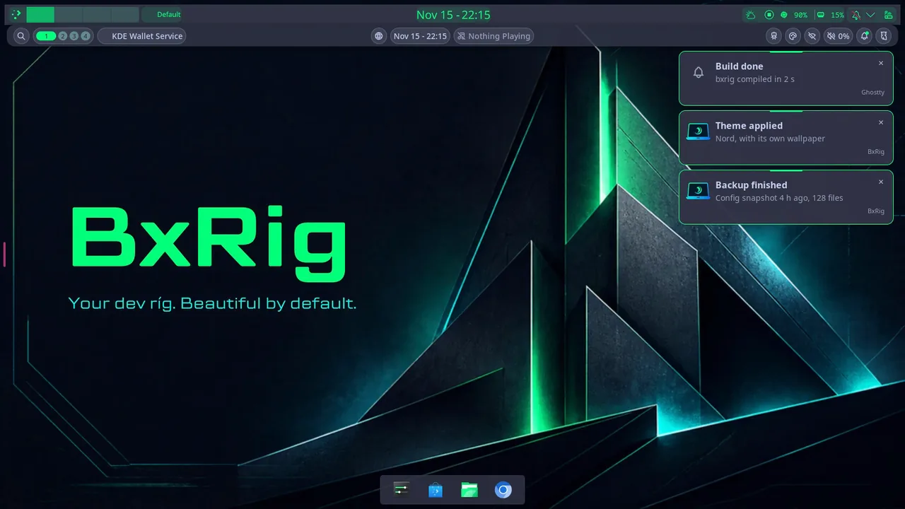
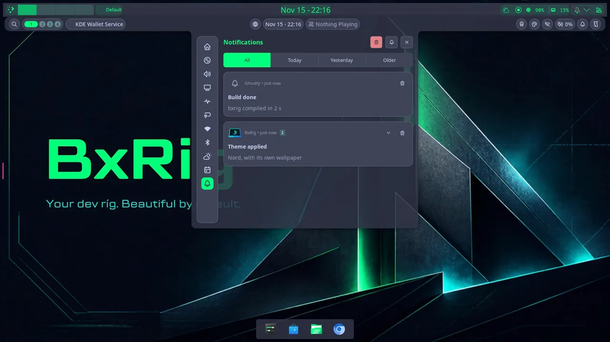
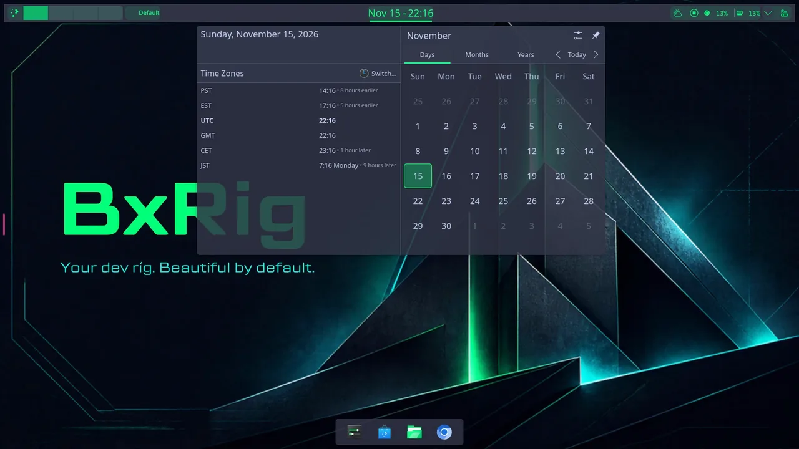

# The desktop

BxRig sets up **Hyprland with Noctalia** as the main desktop. **KDE Plasma** stays installed and gets tiling and a status panel; pick either (or both) at the login screen (`bxrig session set hyprland|plasma`).

## Hyprland and Noctalia

`bxrig setup hyprland` installs the packages one by one and writes the starter configuration once. `~/.config/hypr/hyprland.lua` is yours. BxRig owns `~/.config/hypr/bxrig.lua`, which it regenerates from the [shortcut table](shortcuts.md); never edit that file by hand.

### The bar's panels

The Noctalia bar carries three BxRig panels and the notifications. Each opens from its button on the bar or a key.

| | |
| --- | --- |
| <br>**World clock** · the globe before the time, or <kbd>Super</kbd>+<kbd>Alt</kbd>+<kbd>W</kbd>. The zones are yours: `bxrig time world add Asia/Tokyo --yes` | <br>**Coding agents** · <kbd>Super</kbd>+<kbd>Alt</kbd>+<kbd>A</kbd>. The agents you have installed, their accounts and limits; launch one with a click. **Edit agents** (or `bxrig ai panel add\|remove ID --yes`) chooses which show |
| <br>**Theme switcher** · <kbd>Super</kbd>+<kbd>Ctrl</kbd>+<kbd>Shift</kbd>+<kbd>Space</kbd>. See [Themes](themes.md) | <br>**Notifications** stack in the top corner, rounded and in the theme's colors. <kbd>Super</kbd>+<kbd>Alt</kbd>+<kbd>,</kbd> acts on the newest, <kbd>Super</kbd>+<kbd>Shift</kbd>+<kbd>,</kbd> opens them all |



## KDE Plasma

- **Tiling:** `bxrig setup plasma` installs HyprKwin and turns on the Bluetooth service (`bluetooth.service`, if it is not on yet). Layouts: dwindle, master, monocle, scrolling, stage. `bxrig tiling on|off|status|layout NAME`.
- **Panels:** `bxrig plasma panels apply` replaces your panels with a top status panel (launcher, workspace pager, active window, clock, weather, media, system vitals, tray, in rounded islands with Panel Colorizer) and a bottom dock. Your old layout is backed up first: `bxrig plasma panels undo --yes` restores it. From Hyprland it is applied at your next Plasma login.
- **Virtual desktops:** `bxrig plasma desktops 4`.
- **World clock:** the panel clock reads `Nov 15 - 22:16`; click it for every time zone you chose in the wizard (`bxrig time world`).



Look and hardware have their own pages: [Appearance](appearance.md) for the bar, dock, windows and fonts, and [Displays, power and time](system.md) for monitors, laptop power and the time zone. The [control center](menu.md) has all of it as one menu.

## Everyday tools

| Do | Command | Shortcut |
|---|---|---|
| Control center | `bxrig menu` | `Super+Space` |
| Launch apps | `bxrig runner launch` (the launcher you chose); `bxrig apps` is the All apps window | `Super+Alt+Space` |
| Hardware menu | `bxrig menu open hardware` | `Super+Ctrl+H` |
| Screenshot | `bxrig screenshot screen\|region\|window` | `Print` (region); Mac style also `Super+Shift+3` / `4` / `5` (the `5` menu) |
| Text from the screen | `bxrig screenshot ocr` | in the Capture menu |
| QR codes | `bxrig screenshot qr`, `bxrig qr TEXT` | |
| Color picker | `bxrig screenshot color` | `Super+Print` |
| Record the screen | `bxrig record toggle [--region] [--audio=desktop\|mic]` | `Super+Shift+R` (`Super+Alt+Shift+R` a region, `Alt+Print` with desktop audio) |
| Webcam preview | `bxrig webcam toggle` | `Super+Ctrl+Alt+V` |
| Clipboard history | `bxrig clipboard pick` | `Super+Ctrl+V` |
| Dictation | `bxrig dictation toggle` | `Alt+Space` |
| Do Not Disturb | `bxrig notify dnd toggle`, `notify snooze 30m` | `Super+Ctrl+Alt+Comma` |
| Time, battery, weather | `bxrig notify time\|battery\|weather` | `Super+Ctrl+Alt+T` / `B` / `W` |
| Night shift | `bxrig nightshift on\|off\|toggle` | menu only |
| Hide or show the bar, the dock | `bxrig appearance bar toggle`, `appearance dock toggle` | `Super+Ctrl+Alt+F`, `Super+Alt+D` |
| Emoji | `bxrig emoji` | `Super+Ctrl+E` |
| Force quit | `bxrig forcequit` | `Super+Alt+Escape` |
| Overview | `bxrig overview` | `Super+Ctrl+Up` |
| Minimize / restore | `bxrig window minimize\|restore` | `Super+H` / `Super+Shift+H` |
| Maximize | (Hyprland binding) | `Super+M` |
| Snap to a half | `bxrig window snap left\|right\|top\|bottom` | `Super+Alt+` arrows |
| Center a floating window | (Hyprland binding) | `Super+Alt+Shift+C` |
| Last workspace | (Hyprland binding) | `Super+Ctrl+Tab` |
| Window / workspace to another monitor | (Hyprland binding) | `Super+Ctrl+Shift+` / `Super+Alt+Shift+` arrows |
| Next layout on this workspace | (Hyprland binding) | `Super+Shift+J` |
| Narrower / wider column | (Hyprland binding) | `Super+Minus` / `Super+Equal` |
| Quake console | `bxrig window quake`, `window quake send` | `Super+Shift+Grave` / `Super+Ctrl+Grave` |
| Private browser window | `bxrig browser private [URL]` | `Super+Alt+Shift+B` (Mac style `Super+Shift+N`) |
| File manager in this folder | `bxrig files here [DIR]` | `Super+Alt+Shift+F` |
| Lock | `bxrig system lock` | `Super+Ctrl+L` |
| Pull-down AI shell | `bxrig ai shell` | ``Super+` `` |

Every key is a row of the [shortcut table](shortcuts.md), in the style you chose. The quake console is the special workspace `qconsole`: the first press starts your default terminal on it. The private window uses the default browser (`bxrig default browser`). The webcam preview needs `mpv`, and recording with audio needs `pactl`.

Night shift on Hyprland runs `wlsunset` with your time zone's sunrise and sunset (no network lookup); on Plasma it turns on Plasma's own Night Light.

## Trackpads and Apple devices

`bxrig input gestures --yes` sets up three-finger swipes (workspaces, overview) with `libinput-gestures`. `bxrig input doctor` checks Magic Mouse and Magic Trackpad support (the kernel driver, loaded or built in, Bluetooth, the `input` group). `bxrig input status` finds Apple Magic and Logitech devices and `bxrig input offer` installs the helpers for them (Solaar for Logitech, libratbag and Piper for gaming mice, upower): see [Mice, trackpads and keyboards](input.md). For Option-key characters like a Mac, pick the **English (US, Macintosh)** keyboard layout in the wizard. `bxrig airplay on` starts an AirPlay receiver.

## Hot corners

Rest the pointer in a screen corner to run an action. The defaults are Mac-like: top left the overview, top right the notifications, bottom left the desktop, bottom right the lock screen. Change any corner, on Hyprland (Noctalia) and Plasma (KWin screen edges) alike:

```bash
bxrig hotcorners                                      # what each corner does
bxrig hotcorners set top-left=launcher bottom-right=lock --yes
bxrig hotcorners off --yes
```

Actions: `none`, `overview`, `notifications`, `desktop`, `lock`, `launcher`, `agents`, `themes`. Plasma has no corner action for notifications, agents and themes; those corners do nothing there and the command says so.

## Boot splash

`bxrig setup boot --yes` puts the BxRig splash on the boot screen (Plymouth): the laptop fades in over a soft glow while the dots pulse, and an encrypted disk asks for its password on the same screen. It shows the plan first, keeps a backup of `/etc/mkinitcpio.conf`, and tells you where to add `splash` for your boot loader. `bxrig setup undo boot --yes` puts the previous theme back.

<video src="../assets/clips/boot-splash.webm" poster="../assets/screenshots/boot-splash.webp" autoplay loop muted playsinline width="100%"></video>
