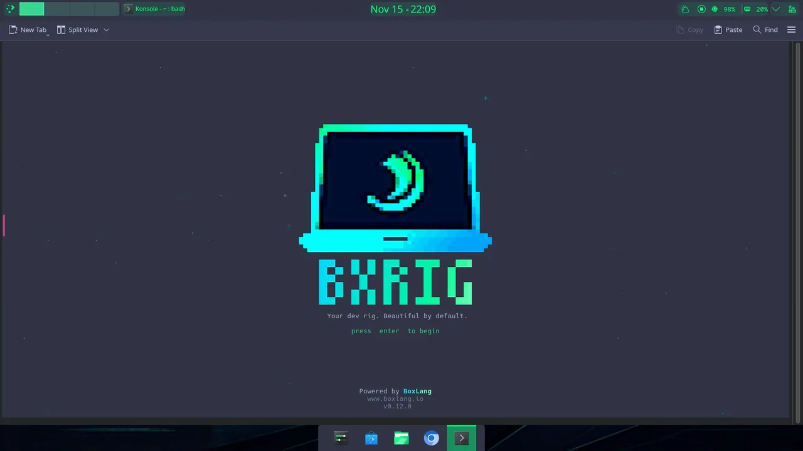
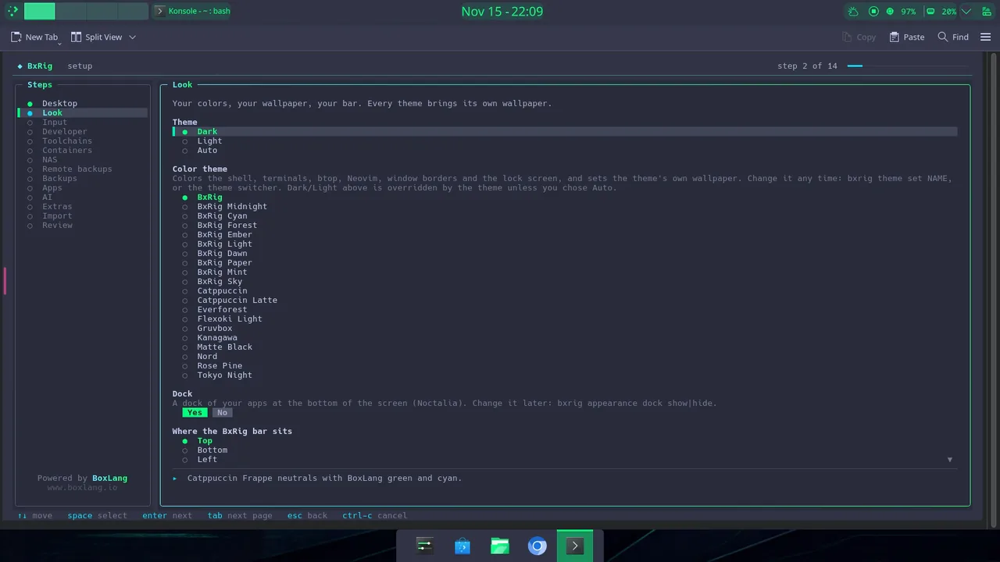
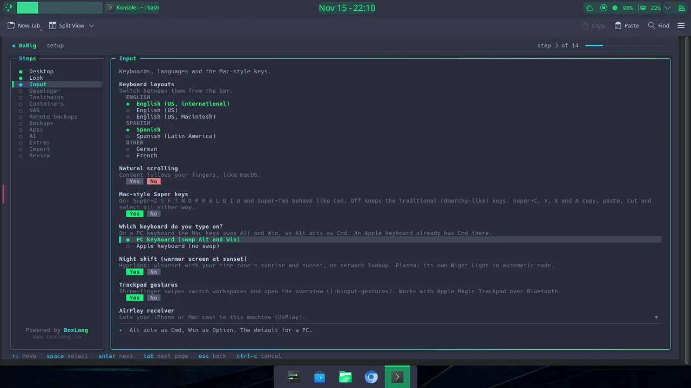

# The setup wizard

`bxrig init` opens a full-screen form with these pages: **Desktop**, **Look**, **Input**, **Developer**, **Toolchains**, **Containers**, **NAS**, **Remote backups**, **Backups**, **Apps**, **AI**, **Extras** and **Import**, then a review screen that lists exactly the commands it will run. With the Customize choice on the Apps page there is one more page per catalog group. Nothing runs until you confirm.

<video src="../assets/clips/wizard.webm" poster="../assets/screenshots/wizard-welcome.webp" autoplay loop muted playsinline width="100%"></video>

| | |
| --- | --- |
| <br>**Welcome** | <br>**Look:** theme, dock, bar position |
| <br>**Look:** the world clock and its time zones | <br>**Input:** layouts, scrolling, shortcut style |

The **Input** page asks about keyboard layouts, natural scrolling, and the shortcut style: "Mac-style Super keys" (on by default) and, when it is on, "Which keyboard do you type on?" (PC: Alt and Win are swapped so Alt acts as Cmd; Apple: no swap). Off keeps the Traditional (Omarchy-like) keys. The answers become `bxrig keys style` and the xremap setup, which is installed either way because copy, paste, cut and select all are remaps in both styles. See [Shortcuts](shortcuts.md).

## Run it again

On a machine that is already set up the wizard starts from your saved answers plus what it finds on the system, and marks installed options with `✓ installed`.

| Command | Starts from |
|---|---|
| `bxrig init` | your saved answers and what the system has (tune) |
| `bxrig init --rerun` | your saved answers only |
| `bxrig init --fresh` | the defaults |
| `bxrig init --from=FILE` | an answers file from another machine |

Nothing the machine already has is ever removed. `bxrig status` shows the same scan without opening the wizard.

## Without a terminal

```bash
bxrig init --answers=answers.json --yes     # apply an answers file
bxrig init --defaults --yes                  # the wizard's default answers
bxrig init --dry-run                         # show the plan only
bxrig init --export=answers.json             # save your answers for another machine
```

Answers are saved in `~/.config/bxrig/answers.json` (mode 600). They never contain secrets.

## Defaults worth knowing

| Question | Default |
|---|---|
| Desktop | Hyprland + Noctalia |
| Shortcut style | Mac-style Super keys on a PC keyboard (Alt and Win swapped) |
| Default browser | Brave |
| Launcher, menu program | Noctalia, Rofi |
| Workspaces | 4 |
| Shell | zsh with the Starship prompt (Catppuccin Powerline) |
| Terminal | Ghostty |
| File manager | Strata |
| Toolchains | Java and Rust |
| Containers | Podman (with `docker` commands mapped to it) |
| Dictation | Superwhisper (Voxtype is the alternative) |
| Updates | stable channel, daily notification |
