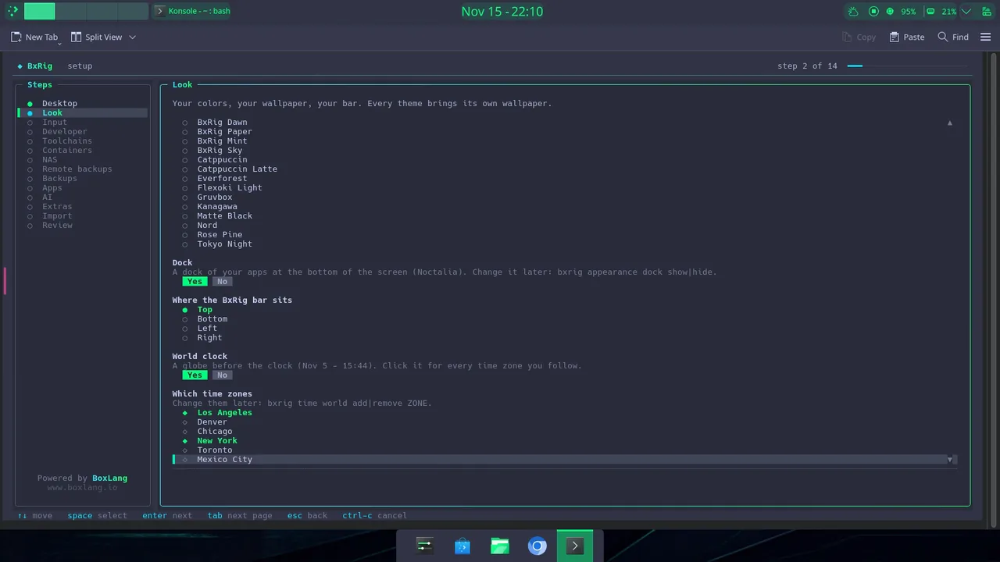

# The setup wizard

`bxrig init` opens a full-screen form with these pages: **Desktop**, **Look**, **Top bar layout**, **App grid style**, **Theme**, **Input**, **Developer**, **Toolchains**, **Containers**, **NAS**, **Remote backups**, **Backups**, **Apps**, **AI**, **Extras** and **Import**, then a review screen that lists exactly the commands it will run. With the Customize choice on the Apps page there is one more page per catalog group. Nothing runs until you confirm.

<video src="../assets/clips/wizard.webm" poster="../assets/screenshots/wizard-welcome.webp" autoplay loop muted playsinline width="100%"></video>

| | |
| --- | --- |
| <br>**Welcome** | <br>**Look:** dark or light, dock, bar position |
| <br>**Look:** the world clock and its time zones | <br>**Input:** layouts, scrolling, shortcut style |

## The look pages

After **Look** (dark, light or auto, the dock, where the bar sits, the world clock) come three pages that show what you are choosing:

- **Top bar layout** (Hyprland and Both): Minimal, Standard (the default and the recommendation) or Dense. Each option draws its bar as a strip of text chips with the dock line below the list. Standard has the capture icon, Minimal does not, Dense adds brightness and weather. The arrow keys select as they move, so the strips and the description follow your cursor and Enter keeps what is highlighted. Later: `bxrig appearance bar layout minimal|standard|dense` or the Look page of the Control Center.
- **App grid style** (Hyprland and Both): Launchpad (the default, big colored tiles on a rounded card) or Terminal-style (flat glyphs, key hints, square corners). Both grids are drawn side by side and the arrow keys switch. Later: `bxrig appearance appgrid launchpad|terminal`.
- **Theme** (every desktop): every theme in `themes/` on a row with a swatch, `BxRig` the default. A pane next to the list shows the palette of the highlighted theme, read from its `colors.toml`, and a sample terminal in those colors. The wizard itself is drawn in the highlighted theme, so what you see is what the desktop will get. The icon set is not asked: BxRig's own icons are used. Later: `bxrig theme set NAME` or the Themes page of the Control Center.

On a terminal narrower than 92 columns (no step list) the Theme page keeps the list and the pane side by side; between 92 and 96 columns the pane is dropped and the rows keep their swatches.

The **Input** page asks about keyboard layouts, natural scrolling, and the shortcut style: "Mac-style Super keys" (on by default) and, when it is on, "Which keyboard do you type on?" (PC: Alt and Win are swapped so Alt acts as Cmd; Apple: no swap). When an Apple Magic or Logitech device is paired or plugged in (or the Mac-style keys are on) it also asks "Input devices" (default: detect); the answer becomes the optional step `bxrig input offer`, see [Mice, trackpads and keyboards](input.md). Off keeps the Traditional (Omarchy-like) keys. The answers become `bxrig keys style` and the xremap setup, which is installed either way because copy, paste, cut and select all are remaps in both styles. See [Shortcuts](shortcuts.md).

## Run it again

On a machine that is already set up the wizard starts from your saved answers plus what it finds on the system, and marks installed options with `✓ installed`.

| Command | Starts from |
|---|---|
| `bxrig init` | your saved answers and what the system has (tune) |
| `bxrig init --rerun` | your saved answers only |
| `bxrig init --fresh` | the defaults |
| `bxrig init --from=FILE` | an answers file from another machine |

Nothing the machine already has is ever removed. `bxrig status` shows the same scan without opening the wizard.

## Without a terminal

```bash
bxrig init --answers=answers.json --yes     # apply an answers file
bxrig init --defaults --yes                  # the wizard's default answers
bxrig init --dry-run                         # show the plan only
bxrig init --export=answers.json             # save your answers for another machine
```

Answers are saved in `~/.config/bxrig/answers.json` (mode 600). They never contain secrets.

## Defaults worth knowing

| Question | Default |
|---|---|
| Desktop | Hyprland + Noctalia |
| Shortcut style | Mac-style Super keys on a PC keyboard (Alt and Win swapped) |
| Top bar layout | Standard |
| App grid style | Launchpad |
| Color theme | BxRig |
| Default browser | Brave |
| Launcher, menu program | Noctalia, Rofi |
| Workspaces | 4 |
| Shell | zsh with the Starship prompt (Catppuccin Powerline) |
| Terminal | Ghostty |
| File manager | Strata |
| Toolchains | Java and Rust |
| Containers | Podman (with `docker` commands mapped to it) |
| Dictation | Superwhisper (Voxtype is the alternative) |
| Updates | stable channel, daily notification |
